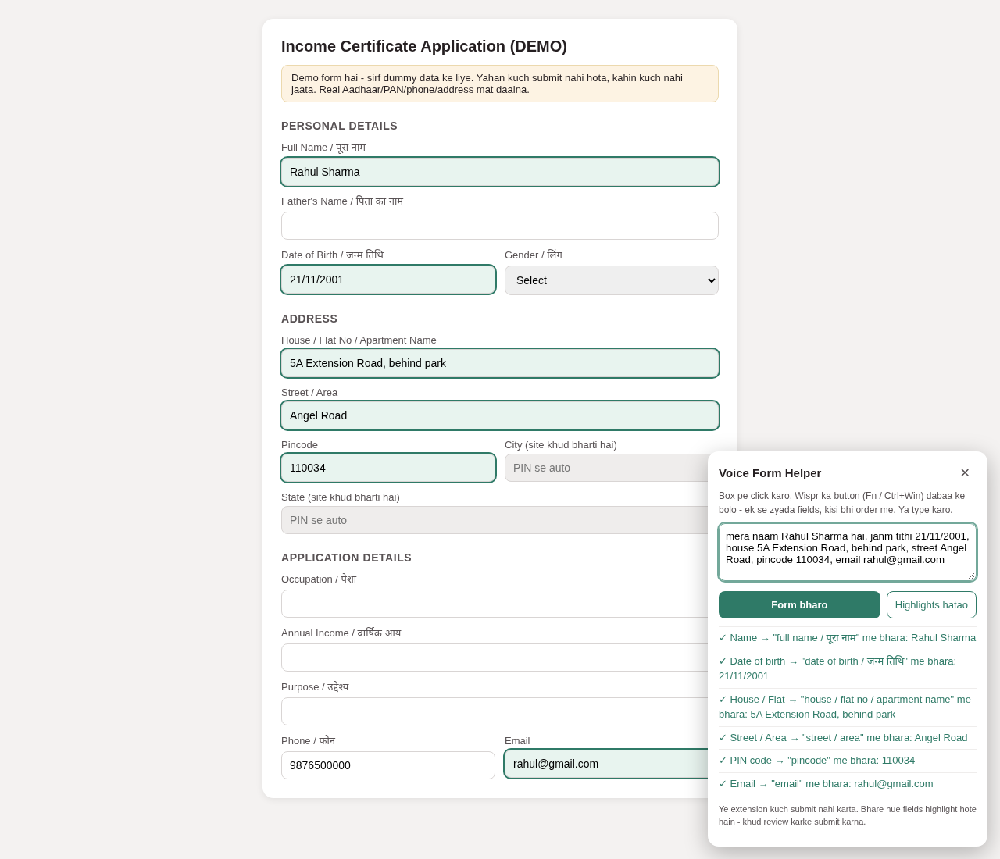
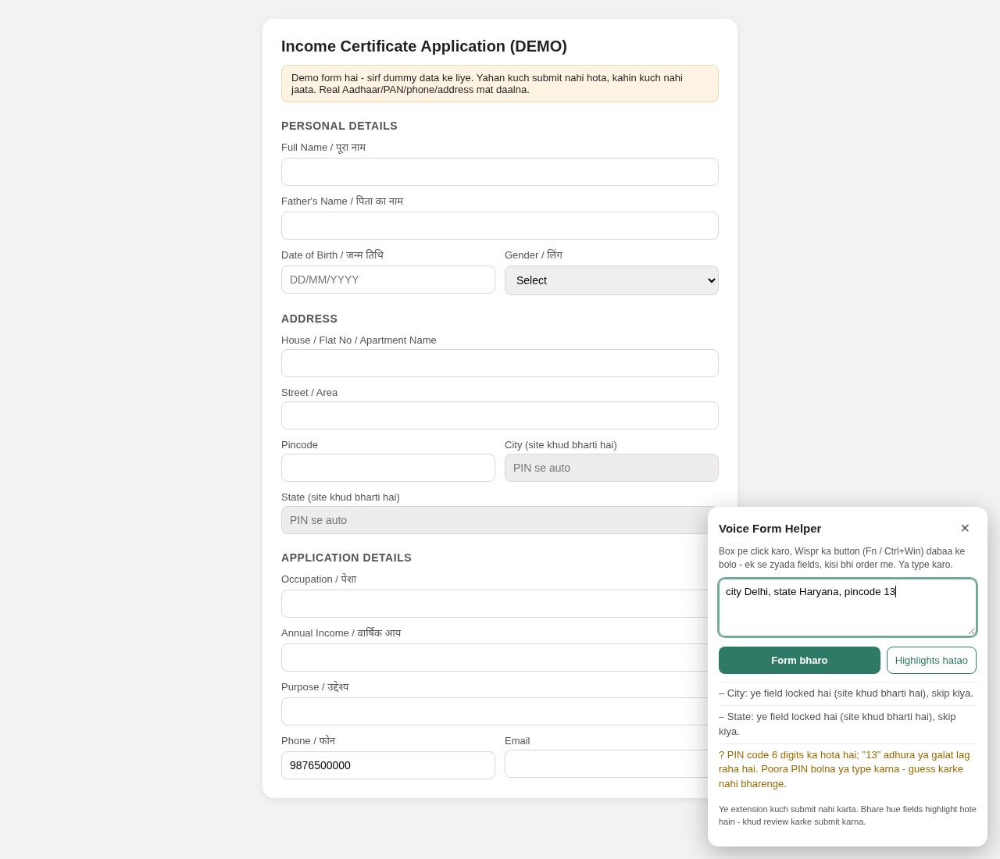

# BoloForm - Voice-Powered Form Filling

A Chrome extension that lets you fill web forms by speaking naturally, in any
order, using [Wispr Flow](https://wisprflow.ai) as the voice input.

Built for **No Hands: The Wispr Flow Challenge** (WeMakeDevs x Wispr Flow).

## The problem

Dictation types into the one field you have focused. Real forms have many
fields. When an address - house, street, PIN - is dictated into a shopping
site's address form, the whole address lands in the House field while Street
and Pincode stay empty. You end up cutting and pasting by hand, which defeats
the point of speaking.

## What BoloForm does

1. Click the extension's toolbar icon (or press **Alt+Shift+B**). A small
   panel opens with a capture box.
2. Dictate into that box with Wispr Flow (Fn on Mac, Ctrl+Win on Windows) -
   or just type. Speak any way you like:
   - Free narration: "mera naam Rahul Sharma hai, janm tithi 21/11/2001"
   - Directed commands: "name field me Rahul Sharma bhar do"
   - Address in one breath: "house 5A Extension Road, behind park, street
     Angel Road, pincode 110034"
   - Corrections: "naam badal do Rahul Verma"
   Hindi, Hinglish and English all work.
3. Press **Form bharo** (or turn on auto-preview to have a dictated
   transcript preview itself after a short pause). BoloForm reads the open
   page's fields, maps each spoken detail to the right one, and shows a
   **preview of the mapping** - which detail goes into which field,
   including any value a fill would replace. Nothing is written yet.
4. Confirm the preview - by clicking **Sahi hai, bharo** or by simply
   dictating or typing "sahi hai", "theek hai", "OK" or "done" into the same box, **then pressing Enter**.
   "Cancel", "mat karo" or "nahi" followed by Enter discards the preview and keeps your
   transcript. Spoken filler around the command is ignored.
5. Filled fields are highlighted; replaced fields show their previous value
   in the panel. Made a mistake? Click **Undo** or say "wapas" and press Enter to restore
   the values from before the fill.
6. If something is incomplete or ambiguous (a 2-digit PIN, a 2-digit phone
   number), the panel asks instead of guessing. Locked/readonly fields (like
   City/State that a site computes from the PIN) are reported as skipped and
   never overwritten. If two spoken details map to the same field, or one
   detail arrives with two different values in one message, the panel asks
   instead of overwriting. And for anything BoloForm cannot place
   confidently, a **Field chuno** button lets you click the exact page field
   yourself - only that field gets filled.
7. BoloForm never submits anything. You review the highlighted fields and
   submit yourself.

The panel header always shows the running version (e.g. `v0.3.2`) so a
screenshot proves which build is loaded.





## Multi-step forms and checkouts

Shopping checkouts and government forms split across several screens. After
a step is filled, the panel looks for the site's own **Next / Continue /
Proceed** button and offers an **Agla step dabao** button. Nothing advances
until you press it. Saying "agla" and pressing Enter simply clears the capture box so you can
dictate the next step's details.

The step button only ever matches navigation words (next, continue, proceed,
agla, aage). It is hard-blocked from ever clicking **Submit**, **Save**,
**Place order**, **Pay** or anything final - the last step is always yours.

## Google Forms and other tricky pages

- **Google Forms**: short answers, paragraphs, radio questions and dates are
  matched from the question text (including the floating-label style where
  no real label element exists), and multi-section forms advance with the
  Agla step button. Google Forms' custom dropdowns are not standard selects;
  use **Field chuno** to pick those by hand.
- **React / framework forms**: fills go through the browser's native value
  setter plus real input/change events, so framework-tracked forms (React,
  and most others) accept them.
- **Radio groups**: "gender female" clicks the Female radio in the group.
- **Date inputs**: "date of birth 21/11/2001" writes `2001-11-21` into a
  real date field.
- **Forms with no labels at all**: fields are matched from HTML
  `autocomplete` tokens (`address-line1`, `postal-code`, `tel`, ...).

## Get Wispr Flow

BoloForm uses [Wispr Flow](https://wisprflow.ai) for voice input. If you do
not have it yet, you can download it through the author's referral link:
<https://wisprflow.ai/r?AVIRAL283>

Tip: add your frequent Hindi/Hinglish commands ("bharo", "sahi hai",
"wapas") to Wispr's personal dictionary so they transcribe exactly the way
you say them.

## Install (local, unpacked)

1. Clone or download this repo (Code > Download ZIP) and unzip it.
2. Open `chrome://extensions`, switch **Developer mode** on (top right).
3. Click **Load unpacked** and select the repo folder (the one containing
   `manifest.json`).
4. Pin the extension from the puzzle icon in the toolbar. The default
   shortcut to open the panel is **Alt+Shift+B** (changeable at
   `chrome://extensions/shortcuts`).
5. To try the included demo form: in the extension's Details page enable
   **Allow access to file URLs**, then open `demo-form.html` in Chrome.

## Try it

Open `demo-form.html` (a dummy income-certificate form with the address
pattern above), click the toolbar icon, dictate or type one of the example
sentences into the panel, and press **Form bharo**. The demo form's phone
field is prefilled with a dummy number on purpose: BoloForm will not touch
it unless you actually dictate a phone number. City/State are readonly and
will be reported as locked.

## Permissions and privacy

- `activeTab` + `scripting` only. The extension activates solely on the tab
  where you click its icon; it has no standing access to any website.
- No network calls, no storage, no accounts. Nothing leaves your browser.
- The panel runs in a closed shadow root, so the page's own scripts cannot
  reach into it.
- The demo form and all examples use dummy data only. Never use real
  Aadhaar, PAN, phone numbers or addresses when testing.

## Test status (honest)

Verified:

- 116 parser checks (`node tests/parser.test.js` + `node tests/parser-stress.test.js`)
  plus 11 background-glue and manifest checks (`node tests/background.test.js`),
  covering narration,
  directed commands, corrections, address splitting, incomplete values,
  Devanagari input, dates, emails, phone/PIN validation, plus regressions
  from real-site tests: Wispr bullet-style transcripts ("- Key: value" and
  directed "field me value bharo" lines), PIN digits embedded in address
  clauses, alphanumeric house numbers, values containing connector words
  like "ka" ("Shanti ka Colony" stays whole), house/flat IDs keeping their
  separators exactly as dictated ("2A/45", "2A-45"), and composite or
  disfluent dictated labels ("house flat number/apartment number: 2A-45")
  leaving only the identifier in the value.
- Five headless-Chrome DOM suites that run the real panel, parser and
  matcher against replicas of real pages (locally served, dummy data, not
  the live sites):
  - `tests/snitch-replica.html` (30 checks): a shopping site's add-address
    form - label collisions ("Name" vs "House / Flat No / Apartment Name"),
    a phone input with no label (only a `+91` chip and numeric placeholder),
    readonly City/State, conflicting duplicate values, preview-then-confirm
    through the real panel, and the manual "Field chuno" pick.
  - `tests/amazon-replica.html` (19 checks): a marketplace address form.
  - `tests/ajio-replica.html` (13 checks): a fashion store's modal address
    dialog - the panel mounts inside the top-layer dialog and page clicks
    cannot dismiss it.
  - `tests/features-replica.html` (42 checks): the v0.3.x feature set -
    React-style value rejection, radio groups, date conversion, dropdown
    precision ("male" never picks "Female"), autocomplete-only forms,
    Google-Forms-style floating question text, spoken confirm/cancel/undo,
    the Agla step flow, the closed shadow panel, and the safety edges:
    command words inside narration never apply, transcript edits invalidate
    a stale preview, ambiguous or final-action buttons are never offered,
    and undo never clobbers a field the user edited after the fill.
  - `tests/stress-replica.html` (28 checks): hostile shapes - duplicate
    identical labels (asks instead of guessing), a select missing the spoken
    option, iframe-trapped fields, a 250-field form (plan stays fast),
    a focus-stealing page, readonly manual picks, double-undo, conflicting
    duplicate values, and a form whose only buttons are Submit/Place order
    (never clicked, never offered).

Not yet verified:

- Real Wispr Flow dictation into the panel - the capture box is a normal
  focused text field, which is exactly what Wispr types into, but the
  end-to-end voice test is pending on a local machine.
- The current fixes on every live site they were written for; retests with
  the reloaded extension are an ongoing step.
- Arbitrary websites. Field matching is rule-based (labels, placeholders,
  input names, autocomplete tokens); unfamiliar label wording may need new
  aliases in `parser.js` (`FIELDS`). This prototype does not claim every
  site or every language.

## Project structure

```
manifest.json    MV3 manifest (activeTab + scripting only, Alt+Shift+B)
background.js    Toolbar click / shortcut -> inject panel into that tab only
content.js       Floating capture panel (closed shadow DOM), voice commands,
                 preview/confirm/undo, multi-step navigation
parser.js        Transcript -> field/value pairs (Hindi/Hinglish/English rules)
matcher.js       Finds page fields (labels, aria, floating text, autocomplete,
                 radios), fills via native setter, highlights, undo
demo-form.html   Dummy demo form (income certificate + address pattern)
tests/           Parser unit tests + four headless DOM replica suites
docs/            Verified UI screenshots
```

## Why Wispr Flow

Wispr Flow's desktop dictation types wherever your cursor is, in 100+
languages. BoloForm treats that as its voice engine: Wispr handles hearing
and transcribing; BoloForm handles understanding which field each detail
belongs to. No developer API or enterprise approval is needed.

## v0.3.2 command-stream safety fix

Typing or dictation alone never executes confirm, cancel, undo or next commands.
A deliberate Enter key (not Shift+Enter, composition, or repeat) or the existing
visible button is required. A pause is not treated as an end-of-speech signal:
slow text such as "sahi hai kya" cannot briefly match a prefix and fill early.
Auto-preview can still show a mapping after a pause, but does not write fields.
This is a deliberate interaction change from v0.3.1, not a timed debounce.
Real Wispr dictation still needs a local-machine retest.
